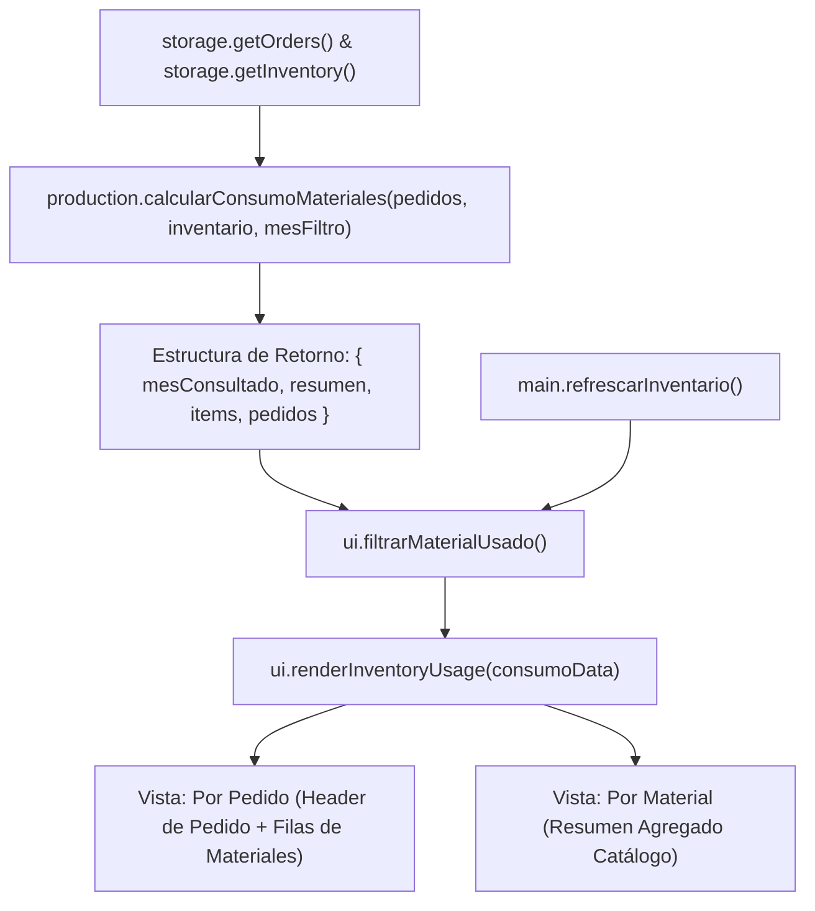

# Plan de Implementación — Spec 039: Reporte de Material Usado / Consumo Ordenado por Pedido

## 1. Arquitectura y Módulos Afectados



### Módulos Modificados:
1. `assets/js/production.js`:
   - Enriquecer `calcularConsumoMateriales`:
     - Recorrer `pedidosValidos` ordenados de forma descendente (por fecha o id correlativo).
     - Para cada pedido, construir un objeto de orden con:
       - `pedidoId`, `clienteNombre`, `fecha`, `mesPedido`, `esMesConsultado`, `status`
       - `totalUnidades`, `costoTotalMateriales`
       - `materiales`: arreglo de cada ítem de material consumido (código, nombre, categoría, unidad, costo unitario, cantidad, costo total).
     - Retornar el arreglo `pedidos` en el resultado junto a `resumen` e `items`.
2. `index.html`:
   - En `#inv-subview-usage`:
     - En la barra de filtros `#inv-usage-filter-bar`, añadir un control de modo de visualización:
       - Botón `#btn-inv-usage-mode-order` ("📋 Por Pedido" — activo por defecto)
       - Botón `#btn-inv-usage-mode-material` ("📦 Por Material")
     - Botón `#btn-inv-usage-all-months` ("Todos") junto a "Mes Actual" para facilitar ver el consumo acumulado de todos los pedidos.
     - Ajustar los encabezados de la tabla `#inv-usage-table-header` para soportar dinámicamente las columnas de "Por Pedido" y "Por Material".
3. `assets/js/ui.js`:
   - Añadir estado `currentUsageViewMode = 'order'` ('order' | 'material').
   - Implementar `cambiarModoVistaUso(modo)` para alternar entre vista por pedido y vista por material.
   - Implementar `limpiarFiltroMesUso()` para ver todos los meses (acumulado).
   - En `renderInventoryUsage`:
     - Si `currentUsageViewMode === 'order'`, renderizar las filas agrupadas y ordenadas por Pedido:
       - Fila cabecera por pedido: N° Pedido, Cliente, Fecha, Estado, Total Unidades, Costo Total.
       - Filas hijas por cada material consumido: Código, Prenda/Estampado, Categoría, Costo Unitario, Cantidad Usada, Subtotal Costo.
     - Si `currentUsageViewMode === 'material'`, renderizar la tabla agregada por material.
   - En `filtrarMaterialUsado`:
     - Filtrar por mes (si hay mes seleccionado; si está vacío, mostrar todos los pedidos).
     - Filtrar por buscador textual sobre ID de pedido, nombre de cliente, material, código, categoría.
   - Exportar `cambiarModoVistaUso` y `limpiarFiltroMesUso` en `NovaprintUI`.
4. `tests/inventory_material_usage.test.js`:
   - Agregar casos de prueba específicos para la ordenación y desglose por Pedido.

---

## 2. Contratos de Funciones

### `production.calcularConsumoMateriales(pedidos, inventario, mesFiltro)`
- **Entrada:**
  - `pedidos: Array<Object>`
  - `inventario: Array<Object>`
  - `mesFiltro: String` (formato `'YYYY-MM'` o vacío para todos)
- **Salida:**
  ```javascript
  {
    mesConsultado: '2026-11',
    resumen: {
      unidadesMes: Number,
      costoMes: Number,
      unidadesAcumulado: Number,
      costoAcumulado: Number,
      totalArticulos: Number,
      totalPedidosMes: Number,
      totalPedidosAcumulado: Number
    },
    items: Array<Object>, // Consolidado por ítem de material
    pedidos: Array<{
      pedidoId: String,
      clienteNombre: String,
      fecha: String,
      mesPedido: String,
      esMesConsultado: Boolean,
      status: String,
      totalUnidades: Number,
      costoTotalMateriales: Number,
      materiales: Array<{
        id: String,
        code: String,
        name: String,
        category: String,
        unit: String,
        unitCost: Number,
        quantity: Number,
        totalCost: Number
      }>
    }>
  }
  ```

---

## 3. Estrategia de Verificación y Cero Regresiones

- Ejecución de `node --test tests/inventory_material_usage.test.js` con las pruebas ampliadas.
- Ejecución completa de `node --test tests/*.test.js` para asegurar que las 31 suites preexistentes (300 tests) sigan pasando al 100%.
- Actualización de `memory.md` en Sección 2 y Sección 3.

