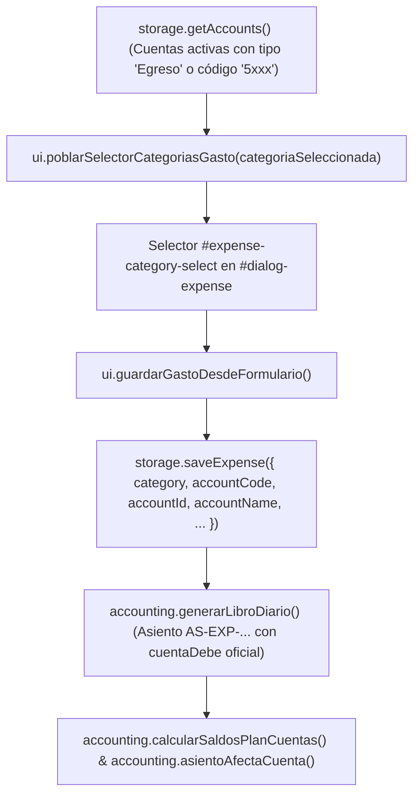

# Plan de Implementación — Spec 040: Enlace de Categoría de Gastos con Plan de Cuentas

## 1. Arquitectura y Componentes Involucrados



### Módulos Modificados:
1. `assets/js/ui.js`:
   - Implementar función reutilizable `poblarSelectorCategoriasGasto(categoriaSeleccionada)`:
     - Obtener las cuentas activas desde `storage.getAccounts()`.
     - Filtrar aquellas con `tipo: 'Egreso'` (o `'Gasto'`) o cuyo código empiece por `'5'`.
     - Generar elementos `<option value="${a.nombre}" data-code="${a.codigo}" data-id="${a.id}">${a.codigo} — ${a.nombre}</option>`.
     - Soportar preselección por nombre, código o coincidencia parcial para retrocompatibilidad.
     - Si la categoría guardada previamente no está en el catálogo, agregarla temporalmente para no perder datos históricos.
   - En `abrirModalNuevoGasto`: invocar `poblarSelectorCategoriasGasto()`.
   - En `editarGasto`: invocar `poblarSelectorCategoriasGasto(g.category || g.accountName || g.accountCode)`.
   - En `duplicarGasto`: invocar `poblarSelectorCategoriasGasto(g.category || g.accountName || g.accountCode)`.
   - En `guardarGastoDesdeFormulario`: extraer `accountCode` y `accountId` del `<option>` seleccionado y almacenarlos en el gasto.
   - Exportar `poblarSelectorCategoriasGasto` en `NovaprintUI`.
2. `index.html`:
   - Ajustar el `<select id="expense-category-select">` para que el placeholder y opciones iniciales sean coherentes con el Plan de Cuentas.
3. `assets/js/accounting.js`:
   - En `generarLibroDiario`:
     - Al generar el asiento de gasto `tipo: 'Gasto'`, enriquecer con `accountCode` y `accountId` provistos en la entidad `gasto`.
   - En `asientoAfectaCuenta` y `calcularSaldosPlanCuentas`:
     - Asegurar que la coincidencia por `accountCode` o `accountId` vincule el asiento de gasto directamente a la cuenta correspondiente.
4. `tests/`:
   - Crear suite de pruebas dedicada `tests/expense_accounts_link.test.js` que verifique:
     - Poblado dinámico de cuentas en el selector.
     - Inclusión de cuentas personalizadas de egreso creadas por el usuario.
     - Persistencia de `accountCode` y `accountId`.
     - Imputación en el Libro Diario y concordancia en `asientoAfectaCuenta`.

---

## 2. Contratos de Funciones

### `ui.poblarSelectorCategoriasGasto(categoriaSeleccionada = '')`
- **Entrada:** `categoriaSeleccionada: String` (nombre, código o ID de la cuenta preseleccionada).
- **Salida:** `void` (actualiza el DOM en `#expense-category-select`).

### Objeto de Gasto Guardado (`storage.saveExpense`)
```javascript
{
  id: 'EXP-XXXXXXXX-XXXX',
  date: 'YYYY-MM-DD',
  category: String,       // Nombre de la cuenta (ej. "Electricidad y Servicios Básicos")
  accountCode: String,    // Código contable (ej. "5202")
  accountId: String,      // ID de la cuenta (ej. "ACC-5202")
  accountName: String,    // Nombre oficial de la cuenta
  description: String,
  amount: Number,
  paymentMethod: String,
  notes: String
}
```

---

## 3. Estrategia de Cero Regresiones

- Ejecución de `node --test tests/expense_accounts_link.test.js`.
- Ejecución completa de `node --test tests/*.test.js` (todas las 31 suites preexistentes / 304 tests) asegurando 100% éxito sin alterar ningún otro módulo.

