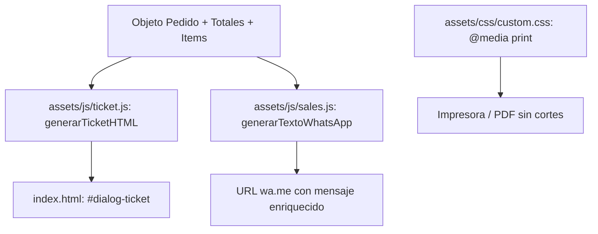

# Plan de Implementación — Spec 050: Comprobante de Venta & Taller Completo (Ticket & WhatsApp)

## 1. Arquitectura y Módulos Afectados



### Módulos a intervenir:
1. **`assets/js/sales.js`:**
   - Actualizar `generarTextoWhatsApp(pedido, settings)`:
     - Formatear cada ítem con precio unitario, subtotal de línea y código de inventario.
     - Incluir Subtotal Bruto, Monto Neto, Total de Prendas, Estado de Pago, Notas del pedido / prenda y datos de empresa.
     - Ajustar encabezado a *"Comprobante de Venta & Taller"*.
2. **`assets/js/ticket.js`:**
   - Actualizar `generarTicketHTML(pedido, settings)`:
     - Resolver datos ampliados del cliente (RUT, dirección) desde el pedido o `NovaprintStorage.getClientById`.
     - Mostrar el Estado de Taller (`pedido.status`) con badge o indicador destacado en el encabezado.
     - Mostrar siempre Subtotal Bruto y Monto Neto en el desglose financiero, manteniendo los bloques de descuento, IVA y delivery.
3. **`assets/css/custom.css`:**
   - Mejorar `@media print`:
     - Desactivar recortes de `dialog#dialog-ticket` y sus hijos (`max-height: none !important; overflow: visible !important;`).
     - Aplicar `break-inside: avoid; page-break-inside: avoid` en filas de tabla y contenedores principales.
     - Configurar `max-width` responsivo que se adapte limpiamente a rollos térmicos de 80mm y formatos Carta/A4 sin desbordamientos.

---

## 2. Contratos de Funciones y Formatos

### A. Contrato `sales.generarTextoWhatsApp(pedido, settings)`
**Entrada:**
- `pedido`: Objeto con `id`, `clientName`, `clientPhone`, `dates`, `status`, `items`, `totals`, `notes`.
- `settings`: Configuración con `businessName`, `rut`, `address`, `phone`, `ticketFooter`.

**Estructura de salida (String formateado WhatsApp):**
```text
👕 *Novaprint Estampados* — Comprobante de Venta & Taller
━━━━━━━━━━━━━━━━━━━━━━
🔖 *N° Comprobante:* NP-20261102-001
📅 *Fecha de Emisión:* 18-11-2026
👤 *Cliente:* Juan Pérez (+56912345678)
🆔 *RUT:* 12.345.678-9  [si existe]
📍 *Dirección:* Av. Providencia 1234 [si existe]
📅 *Compromiso Entrega:* 2026-11-25
⚡ *Estado de Taller:* Confirmado

📦 *Detalle de Prendas & Taller:*
• 10x Polera [POL-001] (L, Negro) - DTF [Adelante] a $10.000 = $100.000
  ↳ Obs: Estampado con tinta reflectante [si existe]

📊 *Resumen Financiero:*
• *Total Prendas:* 10 un.
• *Subtotal:* $100.000
🎁 *Descuento por volumen (10%):* -$10.000  [si aplica]
• *Monto Neto:* $90.000
🏛️ *IVA (19%):* +$17.100  [si aplica]
🚚 *Delivery / Envío:* +$5.000  [si aplica]
💰 *TOTAL A PAGAR:* $112.100
💵 *Monto Abonado:* $50.000
⏳ *SALDO PENDIENTE:* $62.100
💳 *Estado de Pago:* Abonado

📝 *Observaciones / Taller:* Despachar por Starken [si existe]
━━━━━━━━━━━━━━━━━━━━━━
🏢 Novaprint Estampados | RUT: 76.890.123-4
📍 Taller Central Novaprint | Tel: +56987654321
¡Gracias por confiar en Novaprint!
```

### B. Contrato `ticket.generarTicketHTML(pedido, settings)`
- Incluye en la cabecera:
  - `<div class="text-xs font-bold text-blue-700 bg-blue-50 px-2 py-0.5 rounded border border-blue-200">Estado: ${pedido.status}</div>`
  - Datos del cliente: Nombre, Teléfono, RUT y Dirección si están registrados.
- Desglose financiero:
  - Total Prendas: `${pedido.totals.totalQuantity} un.`
  - Subtotal Bruto: siempre presente.
  - Descuento por Volumen: si aplica.
  - Monto Neto: siempre presente.
  - IVA y Delivery: si aplican.
  - Total, Abono, Saldo y Estado de Pago.

---

## 3. Plan de Pruebas Unitarias
Crear `tests/comprobante_venta_taller_completo.test.js`:
1. **WhatsApp:**
   - Verifica que el texto incluya precios unitarios y subtotales por prenda.
   - Verifica códigos de inventario (`[POL-001]`) en los ítems si existen.
   - Verifica que el resumen financiero incluya Subtotal, Neto, Total de Prendas y Estado de Pago.
   - Verifica notas del pedido y de prendas.
   - Verifica datos de la empresa y fecha de emisión.
2. **Ticket HTML:**
   - Verifica inclusión del Estado de Taller (`pedido.status`).
   - Verifica presencia permanente de Subtotal y Neto.
   - Verifica datos ampliados del cliente (RUT, Dirección) cuando existen en catálogo.
3. **CSS de Impresión:**
   - Verifica que `assets/css/custom.css` contenga las reglas de `page-break-inside: avoid`, eliminación de `max-height` y overflow no restrictivo.
