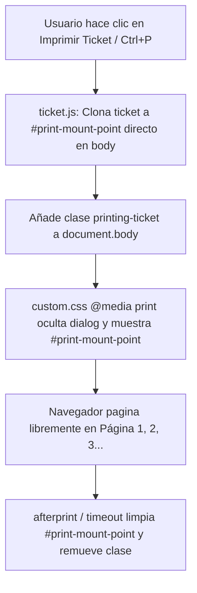

# Plan de Implementación — Spec 051: Corrección de Salto de Página, Visibilidad de Totales y Orden por Código en Comprobante de Venta & Taller

## 1. Arquitectura de Paginación e Impresión



### Componentes a modificar:
1. **`index.html`:**
   - Incorporar al final del `<body>` (fuera de cualquier `<dialog>`):
     `<div id="print-mount-point" class="hidden"></div>`.
2. **`assets/js/ticket.js`:**
   - En `generarTicketHTML(pedido, settings)`:
     - Ordenar los ítems de prendas con `sort` natural por `inventoryCode`.
     - Asignar anchos y `whitespace-nowrap` a las columnas `P. Unit` y `Subtotal` de la tabla de prendas.
     - Asignar la clase `.ticket-totals-section` al contenedor del resumen financiero.
   - En `imprimirTicket()`:
     - Montar el contenido del ticket en `#print-mount-point`.
     - Añadir listener `afterprint` para limpiar el contenedor de impresión.
3. **`assets/js/sales.js`:**
   - En `generarTextoWhatsApp(pedido, settings)`:
     - Ordenar los ítems con el mismo algoritmo por `inventoryCode`.
4. **`assets/css/custom.css`:**
   - En `@media print`:
     - Ocultar todos los `<dialog>` (`dialog, dialog#dialog-ticket { display: none !important; }`).
     - Desplegar `#print-mount-point` con `display: block !important; position: static !important; overflow: visible !important; height: auto !important; width: 100% !important; max-width: 90mm !important; margin: 0 auto !important;`.
     - Establecer `thead { display: table-header-group !important; }` para repetir cabecera de prendas si la tabla se extiende a varias hojas.
     - Configurar `tr, .ticket-totals-section, .ticket-header-section { break-inside: avoid !important; page-break-inside: avoid !important; }`.

---

## 2. Algoritmo de Ordenamiento por Código de Producto

```javascript
function ordenarItemsPorCodigo(items = []) {
  return [...items].sort((a, b) => {
    const codA = (a.inventoryCode || '').trim();
    const codB = (b.inventoryCode || '').trim();
    if (codA && codB) {
      return codA.localeCompare(codB, 'es', { numeric: true, sensitivity: 'base' });
    }
    if (codA && !codB) return -1;
    if (!codA && codB) return 1;
    const prendaA = (a.garmentType || '').trim();
    const prendaB = (b.garmentType || '').trim();
    return prendaA.localeCompare(prendaB, 'es', { sensitivity: 'base' });
  });
}
```

---

## 3. Plan de Pruebas Unitarias
Crear `tests/comprobante_paginacion_totales_orden.test.js`:
1. **Ordenamiento de prendas en Ticket y WhatsApp:**
   - Probar pedido con ítems desordenados (`POL-10`, `POL-2`, sin código, `BUZ-001`).
   - Verificar que en el ticket y en WhatsApp salgan en orden: `BUZ-001`, `POL-2`, `POL-10` y al final el ítem sin código.
2. **Estructura HTML del Ticket:**
   - Verificar clases `whitespace-nowrap` y anchos en columnas `P. Unit` y `Subtotal`.
   - Verificar clase `.ticket-totals-section` en el bloque de finanzas.
3. **Punto de Montaje de Impresión y CSS:**
   - Verificar existencia de `#print-mount-point` en `index.html`.
   - Verificar reglas en `custom.css` para `#print-mount-point`, `table-header-group` y `break-inside: avoid`.
